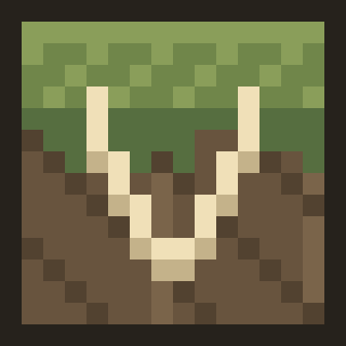
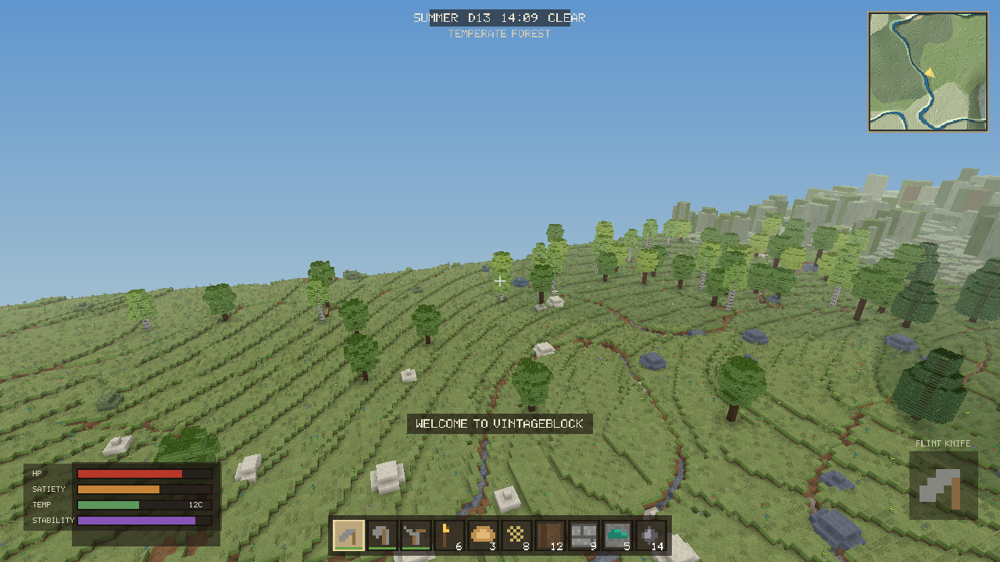
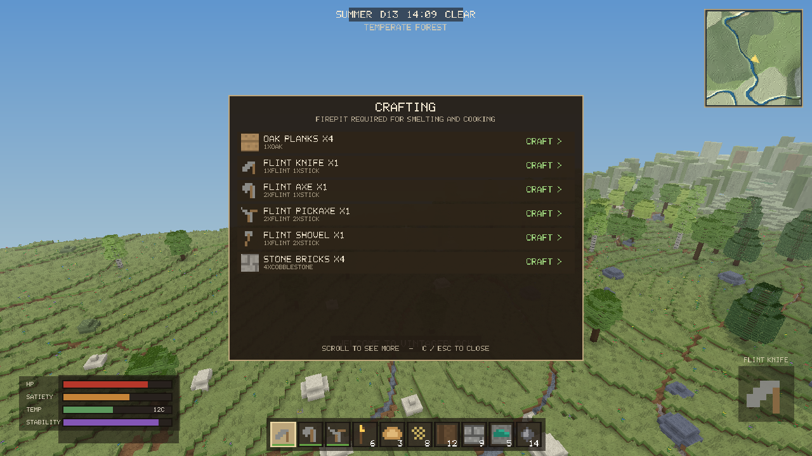

# VintageBlock



**0.1.0 indev** — a *Vintage Story*–inspired voxel sandbox, written from scratch in C++17
with no external dependencies. One self-contained Windows executable, all textures painted
procedurally at startup (8×8 pixel art), geology-based world generation, four levels of
terrain LOD, and hard-bounded worlds of 256×256, 512×512 or 1024×1024 blocks.

[**Download the latest build**](../../releases/latest) — `VintageBlock.exe`, nothing to install.



---

## Run it

```
VintageBlock.exe
```

Double-click it, or run it from a terminal. Requirements:

* Windows 7 or newer, x86_64
* OpenGL 1.1 (present on every Windows install; the game only needs the fixed-function
  pipeline and falls back to client-side vertex arrays when VBOs are unavailable)
* ~120 MB RAM with the default view distance

Nothing to install, no DLLs, no asset files. The world is generated from the seed you type
in the menu, and the texture atlas is painted by code at startup. Saves go next to the exe
(`vintageblock_save.dat` / `vintageblock_player.dat`) — pick **CONTINUE WORLD** in the menu
to resume.

## Controls

| Key | Action |
|---|---|
| `W A S D` | walk |
| `Shift` | sprint |
| `Space` | jump / swim up |
| `Mouse` | look |
| `LMB` | mine (hold) / attack |
| `RMB` | place block / use (eat, light firepit) |
| `1` – `0` | select hotbar slot |
| `Mouse wheel` | scroll hotbar / scroll the recipe list |
| `E` | inventory |
| `C` | crafting |
| `F` | toggle flying (creative mode only) |
| `F1` | cycle view distance |
| `F3` | debug overlay |
| `F5` | save now |
| `Esc` | pause menu / close a window |

World size and game mode are chosen in the main menu. Survival starts you with a flint
knife, a flint axe, a flint pickaxe, torches, some bread and seeds.

## What is simulated

### World generation
* **Hard world limits** – every world is exactly 256×256, 512×512 or 1024×1024 blocks,
  chosen at creation. There is no infinite streaming; the map has a real edge.
* **Climate biomes** – two low-frequency noise fields (temperature, rainfall) plus
  altitude decide between 11 biomes: ice tundra, taiga, boreal forest, temperate forest,
  plains, steppe, savanna, desert, subtropical, rainforest, ocean.
* **Geology / stratigraphy** – 10 rock types (granite, andesite, basalt, slate, shale,
  limestone, chalk, sandstone, peridotite, marble) laid down as **rock strata layers**
  that fold with the terrain, exactly in the Vintage Story spirit. Surface material
  (grass, dry grass, sand, gravel, snow, permafrost) follows biome, height, slope and
  proximity to water.
* **Ore veins** – 11 ores (copper, tin, lead, zinc, iron, magnetite, gold, silver, coal,
  lignite, quartz), each constrained to its host rocks and to a depth band, generated as
  wandering veins. Nuggets and surface boulders hint at what is below.
* **Caves** – 3D noise karst systems with entrances, underground water and deep air
  pockets; about 5 % of the underground volume is hollow.
* **Trees / plants** – 10 tree species with per-species trunk height and canopy shape
  (conical pines, round oaks, kapok giants), plus grass, ferns, flowers, reeds, cattails,
  mushrooms and boulders.
* **Rivers and lakes** – a river network carved along a noise ridge, lakes in basins,
  a global sea level with sand/gravel beaches.

### Survival systems
* **Health, satiety, body temperature, temporal stability.** Cold or heat drain health,
  hunger drains health once satiety is empty, food restores satiety (some give buffs).
  Falls hurt: anything past a three-block drop costs health.
* **Body temperature** is computed from biome temperature, altitude, season, time of day
  and distance to the nearest lit firepit — not a fake constant.
* **Seasons & weather** – 8-day seasons, a 4-season year; temperature swings ±12 °C
  between summer and winter, it snows in winter and in cold biomes, rains elsewhere.
  Crops only grow outside winter.
* **Temporal stability** – a slow-drifting instability field. Below ~45 the world starts
  to twist: drifters spawn even by day, the sky darkens and you lose the ability to run.
* **Creatures** – drifters (hostile, burn in daylight), hares and chickens (passive,
  drop meat/feathers), all simple block-model entities with their own AI states.
* **Mining tiers** – a flint pickaxe cannot mine iron, an iron pickaxe cannot mine
  obsidian; hardness gates break speed and hardness ≥ 250 is unbreakable (like VS).
* **Prospecting** – the copper pickaxe reports the ore it senses around you, with
  distance falloff; the HUD shows the result.
* **Crafting** – 30 recipes: knapping (flint knife/axe/pickaxe/shovel), planks, sticks,
  stone bricks, torches, rope, bowls, firepit, clay pots, smelting copper/bronze/iron
  ingots, tools, gears, bread, stew. Firepit-required recipes need a firepit nearby.
* **Farming** – crop blocks planted on grass, growth over ~3 stages driven by temperature
  and season, harvest back to seeds plus food.

## Rendering

* **8×8 pixel art, all procedural.** 158 texture tiles are painted in code into a
  1024×1024 atlas at boot, with 4 mip levels generated in software (box filter). No
  image files ship with the game.
* **LOD.** Each 32×32×256 chunk is meshed per level: LOD0 is full detail, LOD1/LOD2 drop
  small detail, LOD3 is a coarse blocky shell. Chunk LOD is chosen from camera distance
  (62 % / 82 % / 100 % of view distance), rebuilt when the player crosses a ring, and
  freed when the chunk leaves range.
* **Far terrain.** Beyond the meshed chunks a single coarse mesh (4-block resolution,
  built from the world's coarse map) is drawn to the horizon — the whole 1024×1024 world
  is always visible, never a void.
* **Sky.** Gradient sky driven by a day/night palette, sun and moon billboards, 220
  hash-placed stars, two scrolling procedural cloud layers, linear fog matched to the
  horizon colour, rain and snow.
* **UI** is immediate mode: a 5×7 bitmap font, an item/block icon atlas, a procedural
  minimap of the whole bounded world, durability bars, a damage flash, and the
  crosshair/held-item view.



## Project layout

```
src/vb_common.h        vectors, matrices, frustum, RNG, noise, colour helpers
src/vb_math.cpp        look-at / frustum extraction
src/vb_blocks.h/.cpp   block + item registry, procedural 8x8 texture painters
src/vb_world.h/.cpp    voxel storage (memory compressed sections), light, save/load
src/vb_worldgen.cpp    climate, strata, ores, caves, trees, plants, coarse map
src/vb_mesh.h/.cpp     chunk + coarse mesh builders with per-LOD detail
src/vb_game.h/.cpp     player physics, inventory, crafting, entities, day cycle, streaming
src/vb_render.h/.cpp   OpenGL scene renderer (atlas, sky, clouds, LOD, particles)
src/vb_ui.cpp          HUD, inventory, crafting, menus, hit testing
src/vb_main.cpp        Win32 window, WGL context, input, main loop
src/app.rc             icon + version resource
tools/                 offline soft renderers used to develop without a GPU
```

## Building from source

**Windows** (MSVC or MinGW-w64):

```
build.bat
```

**Linux / macOS cross-compile** (produces a static Windows exe, no dependencies):

```
pip install ziglang      # or install zig
./build.sh
```

`build.sh` also builds the host-side development tools in `out/`:

| tool | what it does |
|---|---|
| `out/preview` | software rasteriser that renders the real chunk mesher to a PNG (`--size --seed --cam --yaw --pitch --radius --map`) |
| `out/uishot` | rasterises the real UI code through a tiny fake GL, so the HUD can be screenshotted headless |
| `out/sim` | headless gameplay loop: walk, dig, place, craft, fall, fight, save/load, registry audit |
| `out/atlas_dump` | writes the generated texture atlas to a PNG |

## Known limitations (indev)

* No sound yet.
* Crafting is a recipe list, not a grid; there is no visual crafting grid UI.
* No multiplayer, no world list — one save slot, saved next to the exe.
* The renderer targets OpenGL 1.1 fixed function on purpose so the exe runs anywhere,
  including VMs and remote desktops; there are no shaders, no shadows, no bloom.
* Verified headless: worldgen statistics, all three world sizes, physics and fall damage,
  save/load round-trip, mesh budgets, crafting and the UI layout (`tools/sim.cpp`,
  `tools/uishot.cpp`). The Windows binary itself has not been exercised on real hardware
  in this environment — report anything that breaks.
